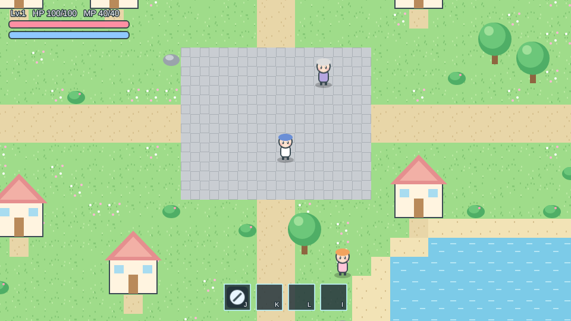
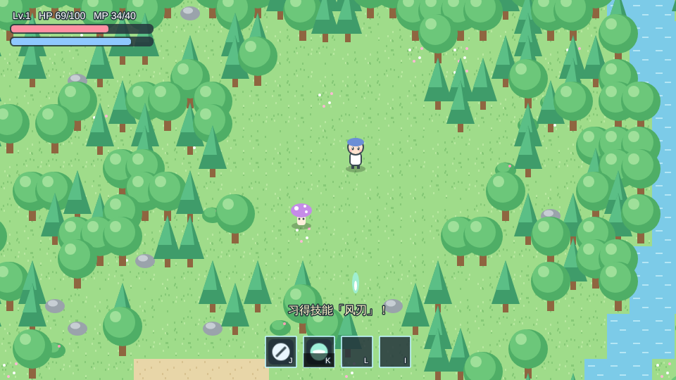

# claude-cursor-project1

claude cursor合作项目1 —— 一个 **2.5D 清新日式动漫风 ARPG**（俯视 3/4 视角，参考双星物语 / 塞尔达梦幻沙漏的手感），以“可扩展”为第一目标搭建。

- **技术栈**：Phaser 3.90 + TypeScript + Vite（浏览器直接运行）
- **分工**：Claude 写核心框架；美术、内容、外围功能由 Cursor 按 [`docs/cursor-tasks/`](docs/cursor-tasks/README.md) 的任务卡补充
- **当前版本**：v0.1.0（基础框架，全部美术为程序化占位图）




> 截图中为程序化占位美术，正式美术由 Cursor 任务替换。

## 运行

```bash
npm install
```

```bash
npm run dev
```

打开 http://localhost:5173 。其它命令：`npm run build`（类型检查 + 打包）、`npm run validate`（校验地图/技能/敌人数据）。

## 操作

| 按键 | 作用 |
|---|---|
| WASD / 方向键 | 移动（8 方向） |
| 空格 | 冲刺（短暂无敌） |
| J / K / L / I | 技能槽 1–4 |
| E | 对话 / 交互 |

## 现在能玩到什么

- **清风村**（50×34 格）：两个 NPC，一颗藏在角落的技能宝珠（治愈之光），东出口 → 森林，南出口 → 海边（未开放）
- **翠风森林**（70×48 格）：史莱姆、孢子菇，两颗技能宝珠（风刃、霜华），北出口 → 湖（未开放）
- 技能：拾取宝珠习得，自动装到空技能槽；战斗以技能为主（近战扇形 / 飞行道具 / 范围 / 治疗）
- 经验与升级、死亡回村、自动存档（localStorage，每次切图）

## 目录速览

```
src/
  core/        全局状态、事件总线         ← Claude 维护
  systems/     地图构建、技能系统、动画约定  ← Claude 维护
  entities/    战斗单位基类、玩家、敌人、AI、NPC
  scenes/      Boot（加载）/ World（地图）/ UI（HUD）
  art/         manifest.ts（正式美术登记处）、placeholders.ts（占位图 = 尺寸规格）
  data/        tiles / skills / enemies JSON，maps/*.json（放进去自动加载）
public/assets/ 正式美术与音频（Cursor 产出放这里）
docs/          架构、数据格式、美术规格、路线图、Cursor 任务卡
tools/         数据校验脚本
```

## 文档入口

- [AGENTS.md](AGENTS.md) —— 任何 AI 代理（Cursor / Cursor Agent / Claude）开工前必读
- [docs/ARCHITECTURE.md](docs/ARCHITECTURE.md) —— 架构与扩展点
- [docs/DATA_FORMATS.md](docs/DATA_FORMATS.md) —— 地图 / 技能 / 敌人数据格式
- [docs/ART_SPEC.md](docs/ART_SPEC.md) —— 美术风格与每个纹理 key 的规格
- [docs/ROADMAP.md](docs/ROADMAP.md) —— 版本计划与备份方式
- [docs/cursor-tasks/](docs/cursor-tasks/README.md) —— Cursor 任务看板
